# Instituto Cooperativo 14 de Abril N.º 8001: sitio web

Sitio web del instituto (Salta): Educación Secundaria, turno mañana, 1.º a 5.º año, Bachiller en Ciencias Naturales.

## Descripción y refactorización (Unidad 4)
El sitio estático del Hito 1 se migró a **PHP**:
- Las 10 vistas pasaron de `.html` a `.php`.
- Se aplicó **Server Side Includes**: `header.php`, `nav.php` y `footer.php` en `includes/` eliminan el código repetido.
- **SSR básico:** el `<title>` cambia según `$titulo_pagina` y el menú marca la página activa (`active` y `aria-current`).
- **Variables de entorno:** `.env` (ignorado por Git) con `.env.example` como plantilla, leído por `config/env.php`.

## Prototipo de Figma
- Figma: https://github.com/Fer-2026/Dise-o-UI-UX-Mockup-Figma-
- Mockups exportados: https://www.figma.com/make/UL3GSEQOHBF6XCXKV9COQ8/High-Fidelity-Mockups-for-School?t=qmuPPG4mTDi6oJpE-1

## Tecnologías
HTML5, CSS3, Bootstrap 5.3, JavaScript, PHP 8.x, XAMPP / Laragon, Git y GitHub, Prettier.

## Estructura
```
api/                  endpoint JSON de cursos (TP9)
app/                  Models, Controllers y Views del CRUD en MVC nativo (TP10)
config/               env.php, conexion.php y sesion.php
includes/             header.php, nav.php, footer.php
admin/                front controller del CRUD de cursos (TP10)
css/  js/  img/       recursos y buscador asincrónico (TP9)
*.php                 vistas públicas, registro, login, paneles, cursos y logout
sql/                  usuarios_tp8.sql, cursos_tp9.sql y novedades_tp10.sql
docs/                 capturas y pruebas de TP8, TP9 y TP10
tp6/                  normalización, schema.sql y consultas.sql
tp10/framework/       proyecto CodeIgniter 4 con el módulo Novedades (TP10)
.env.example          plantilla de variables
```
## Instalación y ejecución local
1. Instalá **XAMPP** (o **Laragon**) con PHP 8.x.
2. Cloná el repositorio dentro de la carpeta del servidor:
   - XAMPP: `C:\xampp\htdocs\`
   - Laragon: `C:\laragon\www\`
```bash
git clone https://github.com/Fer-2026/Pagina-PHP.git
cd Pagina-PHP
cp .env.example .env
```
3. Iniciá **Apache** (XAMPP: botón *Start*; Laragon: *Iniciar todo*).
4. Abrí http://localhost/instituto-php/
5. Edit­á `.env` si querés cambiar el nombre, el correo o el entorno.

Alternativa sin XAMPP: `php -S localhost:8000` dentro de la carpeta.

## Evidencia de funcionamiento


## Flujo de Git
Ramas `feature/maquetacion` y `feature/migracion-php-ssi`, integradas a `main` con Pull Request.

## Fuentes
Datos del instituto: sitios públicos y su perfil de Instagram. Los nombres del equipo docente son ficticios (maqueta). Agenda: PDF institucional 2026.


## Clase 5: Procesamiento de formularios y seguridad web

Todo el desarrollo de esta entrega está en la carpeta [`clase5/`](clase5/). Es una copia del sitio modular en PHP (SSI) con dos formularios nuevos que se procesan en el servidor.

### Formulario POST: contacto
Archivo: [`clase5/contacto.php`](clase5/contacto.php). Campos: nombre, correo electrónico, teléfono (opcional), asunto y mensaje.

- **Sanitización de entradas:** cada dato recibido por `$_POST` pasa por `filter_input()`, `trim()` y la función `limpiar()`, que quita caracteres de control y limita el largo. Nada se usa ni se muestra sin sanitizar.
- **Prevención de XSS:** todo lo que se muestra en pantalla se escapa con `htmlspecialchars()` (función `e()`), por lo que un `<script>` se ve como texto y no se ejecuta.
- **Validación en el servidor:** campos obligatorios con `empty()`, correo con `filter_var(FILTER_VALIDATE_EMAIL)`, formato del nombre y del teléfono con expresiones regulares, asunto contra una lista permitida y largo mínimo del mensaje.
- **Mensajes al usuario:** lista de errores en la parte superior, mensaje de error debajo de cada campo y mensaje de éxito con el resumen de lo recibido.
- **Persistencia de datos:** si hay errores, los campos completados se conservan para no tener que reescribirlos.
- **Seguridad adicional:** token CSRF guardado en la sesión y verificado con `hash_equals()`. Tras un envío correcto se redirige a la página (patrón Post/Redirect/Get) para evitar reenvíos al recargar.

### Formulario GET: buscador
Archivo: [`clase5/buscar.php`](clase5/buscar.php). Parámetros: `q` (texto a buscar) y `tipo` (tipo de evento de la agenda). El buscador está disponible en el menú de todas las páginas.

- Busca en las páginas del sitio y en los eventos de la agenda 2026.
- `q` se sanitiza con `filter_input()` y `limpiar()`. `tipo` se valida contra una lista permitida: cualquier otro valor se descarta.
- Mensajes para búsqueda vacía, de menos de 2 caracteres, sin resultados y con resultados.

### Capturas de pantalla

**Validación con campos vacíos**


**Datos conservados después de un error**


**Envío exitoso**


**Intento de XSS mostrado como texto**


**Búsqueda con resultados**


**Búsqueda sin resultados**


**Validación de la búsqueda**


**Estructura de la carpeta clase5**


### Ejecución local
Con XAMPP o Laragon iniciado, abrir `http://localhost/instituto-php/clase5/` (requiere PHP 8.x con la extensión `mbstring`, activada por defecto en XAMPP).

## TP6: Diseño y creación del esquema relacional en MySQL

La base de datos del proyecto está en la carpeta [`tp6/`](tp6/):

- [`NORMALIZACION.md`](tp6/NORMALIZACION.md): normalización paso a paso (1FN, 2FN, 3FN), tablas con claves y diagrama entidad-relación.
- [`schema.sql`](tp6/schema.sql): creación de la base `instituto_14_abril` con 9 tablas (roles, usuarios, tipos de evento, años, eventos, relación evento-año, asuntos, estados y consultas), claves primarias y foráneas, campos de auditoría e índices.
- [`consultas.sql`](tp6/consultas.sql): inserciones, `SELECT` con `WHERE`, `ORDER BY` e `INNER JOIN`, `UPDATE` y `DELETE`.

Instrucciones de ejecución y capturas en [`tp6/README.md`](tp6/README.md).

## TP8: Manejo de estado, sesiones y autenticación

El TP8 está integrado al sitio principal: se agregó registro de usuarios, inicio y cierre de sesión, un guardián reutilizable y dos paneles protegidos por rol. La misma base `instituto_db` del CRUD de cursos se usa para la tabla `usuarios`.

### Archivos principales

| Archivo | Función |
|---|---|
| [`sql/usuarios_tp8.sql`](sql/usuarios_tp8.sql) | Crea `usuarios` y carga las cuentas semilla con contraseñas bcrypt. |
| [`config/sesion.php`](config/sesion.php) | Inicia la sesión, configura la cookie, calcula `BASE_URL` y ofrece helpers CSRF y de autenticación. |
| [`auth_guard.php`](auth_guard.php) | Verifica `$_SESSION['usuario_id']`, redirige al login y restringe el rol `admin`. |
| [`registro.php`](registro.php) | Sanitiza y valida los datos, comprueba el correo único y guarda `password_hash(..., PASSWORD_BCRYPT)`. |
| [`login.php`](login.php) | Usa `password_verify()`, regenera el ID de sesión y guarda `usuario_id`, `usuario_nombre` y `rol`. |
| [`logout.php`](logout.php) | Ejecuta `session_unset()`, elimina la cookie y destruye la sesión. |
| [`dashboard.php`](dashboard.php) | Vista protegida para cualquier usuario autenticado; muestra los datos de `$_SESSION`. |
| [`admin_panel.php`](admin_panel.php) | Vista restringida al rol `admin`, con usuarios, contadores y accesos. |
| [`admin/`](admin/) | CRUD de cursos protegido con `define('REQUERIR_ROL', 'admin')`. |

### Estructura de `usuarios`

```sql
id          INT UNSIGNED AUTO_INCREMENT PRIMARY KEY
nombre      VARCHAR(100) NOT NULL
email       VARCHAR(150) NOT NULL UNIQUE
password    VARCHAR(255) NOT NULL
rol         VARCHAR(20) NOT NULL DEFAULT 'usuario'  -- admin | usuario
created_at  TIMESTAMP NOT NULL DEFAULT CURRENT_TIMESTAMP
```

Además hay un índice sobre `rol` y una restricción `CHECK` para aceptar solamente `admin` o `usuario`.

### Cuentas de prueba

| Rol | Correo | Contraseña |
|---|---|---|
| admin | `admin@instituto.edu.ar` | `Admin123!` |
| usuario | `usuario@instituto.edu.ar` | `Usuario123!` |

Las cuentas `lucia.gomez@example.com` y `martina.rios@example.com` que aparecen en las capturas se crearon desde el formulario de registro durante la prueba. El SQL deja solo las dos cuentas semilla para que la corrección sea reproducible.

### Cómo ejecutar

1. Iniciar **Apache** y **MySQL** desde XAMPP.
2. Importar el esquema desde phpMyAdmin o por consola:

   ```bash
   mysql -u root < sql/usuarios_tp8.sql
   ```

3. Verificar la conexión en [`config/conexion.php`](config/conexion.php): base `instituto_db`, usuario `root` sin contraseña en el entorno local.
4. Abrir `http://localhost/instituto-php/registro.php` para crear una cuenta o `http://localhost/instituto-php/login.php` para ingresar.
5. Probar las rutas protegidas `dashboard.php`, `admin_panel.php`, `admin/index.php` y el cierre de sesión en `logout.php`.

### Cumplimiento de los requisitos

| Requisito del TP8 | Implementación |
|---|---|
| Tabla `usuarios` con `id`, `nombre`, `email` único, `password` de 255, `rol` y `created_at`. | [`sql/usuarios_tp8.sql`](sql/usuarios_tp8.sql). |
| Registro con sanitización estricta. | `strip_tags()`, normalización de espacios, `FILTER_SANITIZE_EMAIL`, validación de nombre, correo y contraseña en [`registro.php`](registro.php). |
| Correo único. | Consulta preparada antes del `INSERT` y restricción `UNIQUE` en la base. |
| Contraseña con `password_hash(..., PASSWORD_BCRYPT)`. | [`registro.php`](registro.php), línea del hash; la base guarda hashes de 60 caracteres con prefijo `$2y$10$`. |
| Consultas preparadas. | `PDO::prepare()` y `execute()` en registro, login, dashboard, panel y CRUD. |
| Login con `password_verify()`. | [`login.php`](login.php), comparación del hash y mensaje genérico ante credenciales incorrectas. |
| `session_start()`. | Se centraliza en [`config/sesion.php`](config/sesion.php), incluido antes de cualquier salida; `login.php` además verifica `session_status()`. |
| `session_regenerate_id(true)` y variables de sesión. | [`login.php`](login.php): se regenera el ID y se guardan `usuario_id`, `usuario_nombre`, `rol`, correo y último login. |
| Redirección al panel protegido. | El administrador va a `admin_panel.php`; el usuario común va a `dashboard.php`. |
| `auth_guard.php` con `$_SESSION['usuario_id']`. | [`auth_guard.php`](auth_guard.php): sin sesión redirige a `login.php?error=acceso_denegado`. |
| Proteger al menos dos vistas. | `dashboard.php`, `admin_panel.php` y las cuatro rutas del CRUD de cursos. |
| `admin_panel.php` solo para `admin`. | `define('REQUERIR_ROL', 'admin')` antes de incluir el guardián; un usuario común es redirigido a `dashboard.php?error=sin_permiso`. |
| Logout con `session_unset()`, cookie y `session_destroy()`. | [`logout.php`](logout.php), con redirección a `login.php?logout=ok`. |
| Integración en la app principal. | Header, navbar y footer usan `BASE_URL`; el topbar muestra los accesos de autenticación y el CRUD usa el mismo layout del sitio. |

### Medidas de seguridad adicionales

- Token CSRF con `hash_equals()` en registro, login y formularios del CRUD.
- Escape de salida con `e()` (`htmlspecialchars`) en todas las vistas.
- Cookie de sesión con `HttpOnly`, `SameSite=Lax` y ruta `/instituto-php/`.
- Mensaje genérico «Correo o contraseña incorrectos» para no revelar si un correo existe.
- El rol del formulario público no se toma de `$_POST`: siempre se asigna `usuario`.
- `main.js` solo intercepta los formularios estáticos de la maqueta (sin `action` o con `action="#"`); los formularios reales de registro, login y CRUD se envían al servidor.

### Capturas de evidencia

**1. Sitio como invitado, con accesos a Ingresar y Crear cuenta**

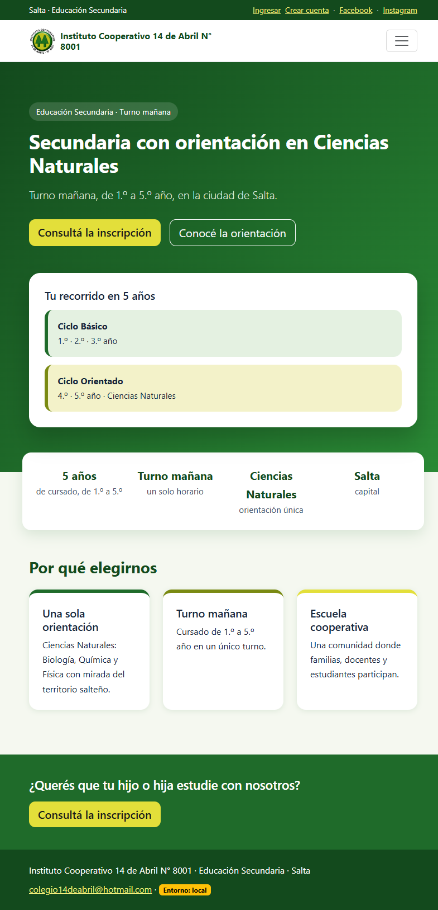

**2. Formulario de registro completo**

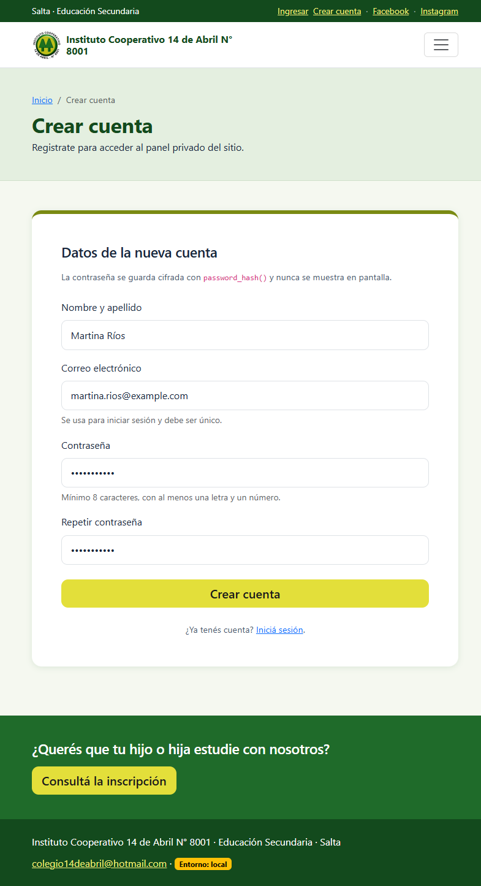

**3. Correo duplicado rechazado**

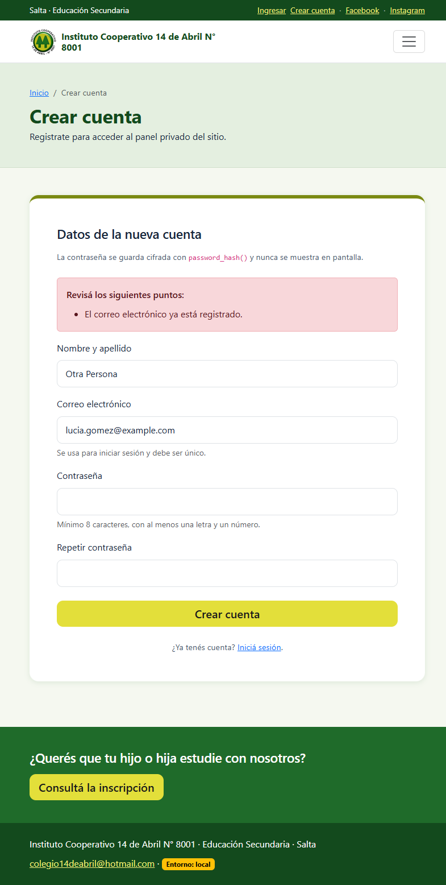

**4. Registro exitoso y aviso para iniciar sesión**

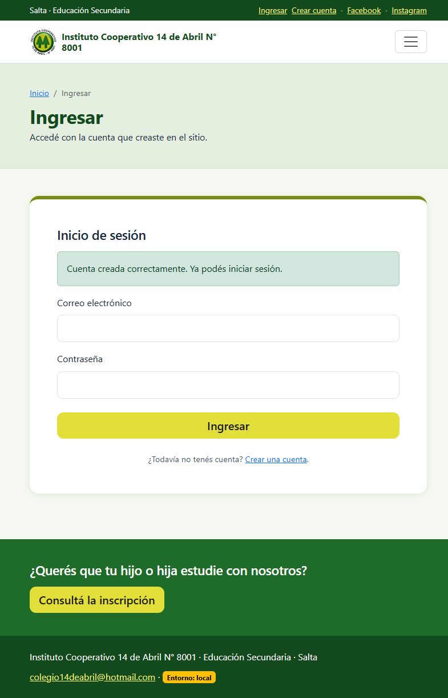

**5. Formulario de login**

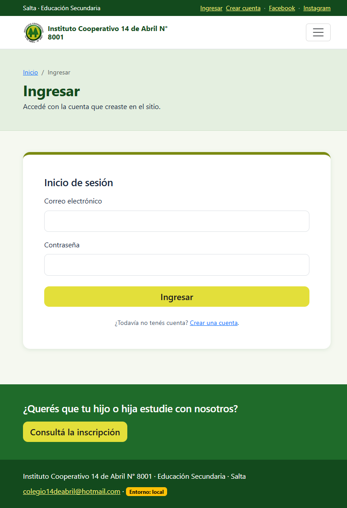

**6. Credenciales incorrectas**

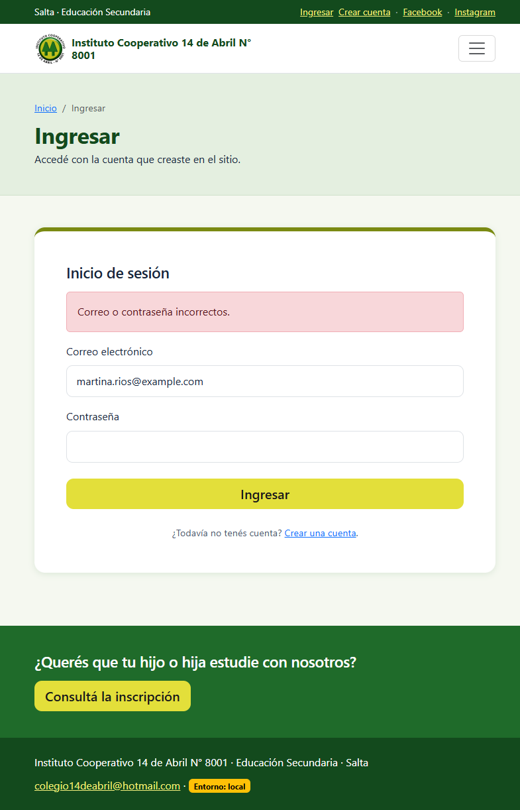

**7. Panel del usuario con las variables de `$_SESSION`**

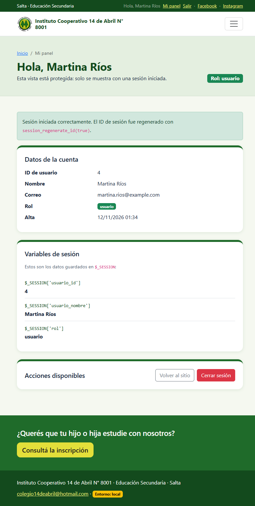

**8. Un usuario común no puede entrar a `admin_panel.php`**

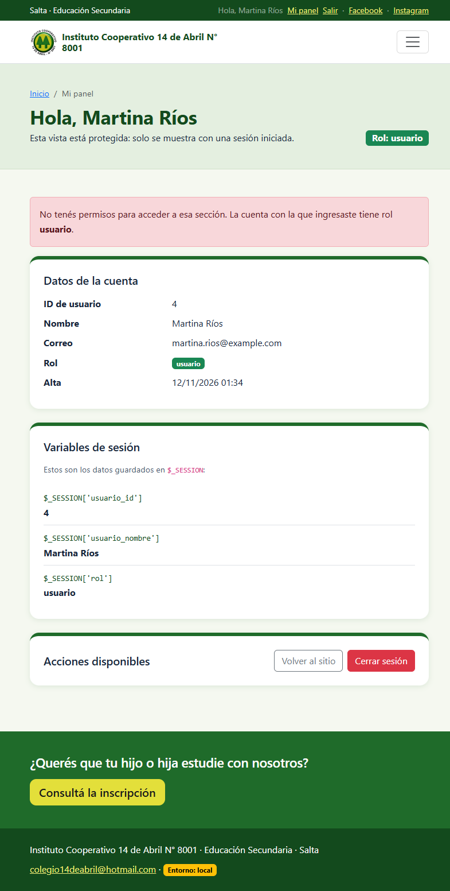

**9. Logout correcto**


**10. `dashboard.php` sin sesión redirige al login**

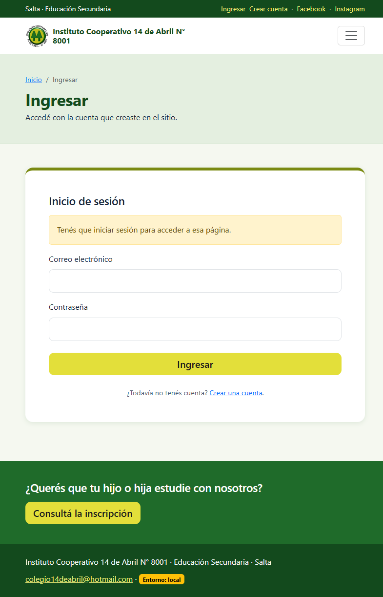

**11. Panel de administración con usuarios y contadores**

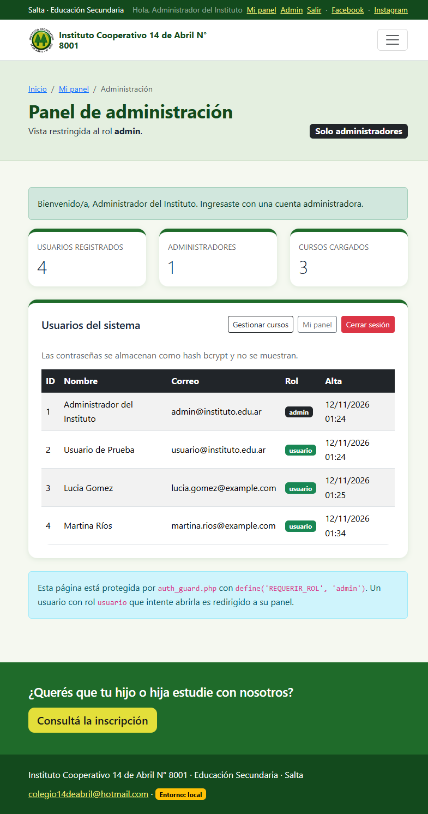

**12. CRUD de cursos integrado y protegido**

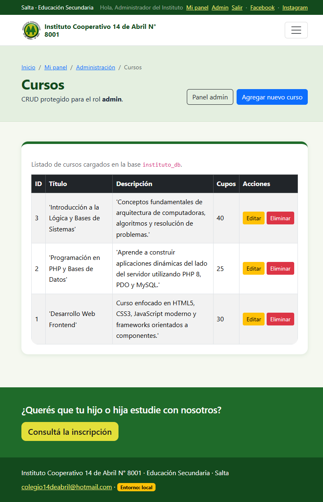

**13. Header con sesión de administrador**

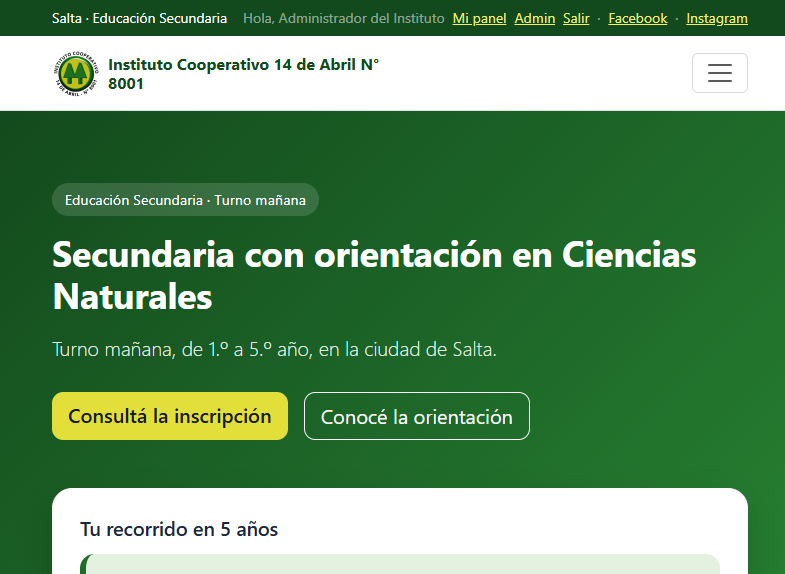

**14. Estructura de la tabla `usuarios` en phpMyAdmin**

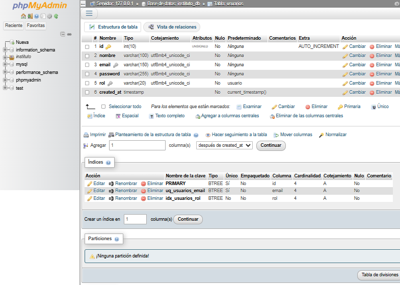

**15. Usuarios guardados con hash bcrypt, rol y fecha de alta**

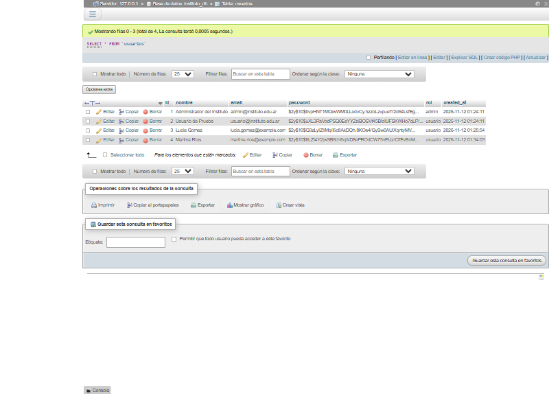

### Pruebas y resultados

El detalle de los 20 casos probados, los redirects del guardián, la regeneración del ID de sesión, las cookies y el CRUD está en [`docs/tp8-pruebas.md`](docs/tp8-pruebas.md).

## TP9: Comunicación asincrónica y APIs (AJAX & JSON)

El TP9 está integrado al sitio con una página pública de **Cursos y talleres** que consulta la tabla `cursos` mediante `fetch()` y actualiza únicamente los resultados, sin recargar el documento.

### Funcionalidad

- **Endpoint propio:** `api/cursos.php` responde JSON para el listado, la búsqueda por texto y el detalle por ID.
- **Buscador en vivo:** `cursos.php` + `js/cursos.js`; el evento `input` se procesa con un debounce de 300 ms.
- **Estados de interfaz:** carga, resultados, sin coincidencias y error de red.
- **Integración:** enlace en **Académico → Cursos y talleres** y acceso desde `propuesta-educativa.php`.
- **Base de datos:** tabla `cursos` del TP7; `sql/cursos_tp9.sql` deja el esquema y datos de ejemplo.

### Endpoint

| Operación | Ejemplo | Éxito |
|---|---|---|
| Listar | `GET /instituto-php/api/cursos.php` | `200` + arreglo `data` |
| Buscar | `GET /instituto-php/api/cursos.php?q=web` | `200` + coincidencias |
| Detalle | `GET /instituto-php/api/cursos.php?id=1` | `200` + curso |
| Sin coincidencias | `GET /instituto-php/api/cursos.php?q=robotica` | `200` + `data: []` |

Códigos previstos: `200` éxito, `400` parámetros inválidos, `404` ID inexistente, `405` método distinto de GET y `500` error de consulta. Todas las respuestas usan `Content-Type: application/json; charset=utf-8` y `json_encode()`.

Ejemplo de respuesta:

```json
{
  "status": "success",
  "data": [
    {
      "id": 1,
      "titulo": "Desarrollo Web Frontend",
      "descripcion": "Curso enfocado en HTML5, CSS3, JavaScript moderno y frameworks orientados a componentes.",
      "cupos": 30
    }
  ],
  "count": 1,
  "query": "web",
  "limit": 20
}
```

### Cumplimiento de los requisitos

| Requisito del TP9 | Implementación |
|---|---|
| Endpoint independiente | `api/cursos.php` |
| Respuesta JSON | `header('Content-Type: application/json; charset=utf-8')` y `json_encode()` |
| PDO + consultas preparadas | `prepare()` con parámetros `:titulo`, `:descripcion` e `:id` |
| Códigos HTTP | `200`, `400`, `404`, `405` y `500` |
| Evento del usuario | `input` con debounce, `submit` del formulario y `click` en **Limpiar** |
| Fetch API | `fetch()` con `AbortController` y cabecera `Accept: application/json` |
| Manejo de errores | `try/catch`, validación de `response.ok` y alerta visible |
| Procesar JSON | `await response.json()` y validación de `status` |
| Actualizar solo una sección | `#resultadosCursos` y `#estadoCursos`; no se recarga la página |
| Integración | Navegación, diseño compartido, CTA y base `instituto_db` |

### Capturas de evidencia

1. Página inicial con los tres cursos: [01-cursos-inicial.png](docs/capturas/tp9/01-cursos-inicial.png)
2. Búsqueda “web” sin recargar: [02-busqueda-web.png](docs/capturas/tp9/02-busqueda-web.png)
3. Búsqueda sin coincidencias: [03-busqueda-sin-resultados.png](docs/capturas/tp9/03-busqueda-sin-resultados.png)
4. Error de red simulado: [04-error-de-red-simulado.png](docs/capturas/tp9/04-error-de-red-simulado.png)
5. JSON `200`: [05-api-json-200.png](docs/capturas/tp9/05-api-json-200.png)
6. JSON `404`: [06-api-json-404.png](docs/capturas/tp9/06-api-json-404.png)
7. JSON `400`: [07-api-json-400.png](docs/capturas/tp9/07-api-json-400.png)
8. Tabla `cursos` en phpMyAdmin: [08-phpmyadmin-cursos.png](docs/capturas/tp9/08-phpmyadmin-cursos.png)

### Pruebas y resultados

El detalle de los casos de endpoint, las pruebas de Fetch, el intento de inyección SQL, la prueba de error de red y las capturas está en [`docs/tp9-pruebas.md`](docs/tp9-pruebas.md).

### Cómo ejecutar

1. Iniciar Apache y MySQL.
2. Abrir `http://localhost/instituto-php/cursos.php`.
3. Buscar `web`, `php` o `robotica`, y probar **Buscar** y **Limpiar**.
4. Para una instalación limpia, importar [`sql/cursos_tp9.sql`](sql/cursos_tp9.sql).

## TP10: Patrón MVC e introducción a frameworks

El TP10 se resolvió en dos partes complementarias: el CRUD de cursos existente se refactorizó a **MVC nativo** y se agregó un **módulo independiente de Novedades** con **CodeIgniter 4**.

### Parte A: CRUD de cursos en MVC nativo

La URL histórica `admin/index.php` se conserva como **front controller**. La lógica se separó en:

```text
app/
  autoload.php
  Models/Curso.php
  Controllers/CursoController.php
  Views/cursos/index.php
  Views/cursos/form.php
  Views/cursos/eliminar.php
```

- **Modelo:** `App\Models\Curso` concentra las consultas `SELECT`, `INSERT`, `UPDATE` y `DELETE` con PDO y sentencias preparadas.
- **Controlador:** `App\Controllers\CursoController` recibe la acción, valida los datos, verifica el token CSRF, llama al modelo y redirige o renderiza la vista.
- **Vistas:** `app/Views/cursos/*.php` contienen HTML y datos escapados con `e()`; no tienen SQL.
- **Compatibilidad:** `admin/crear.php`, `admin/editar.php` y `admin/eliminar.php` quedaron como capas delgadas que delegan en el front controller. La eliminación ahora se confirma con `POST` y CSRF.
- **Acciones:** `listar`, `crear`, `guardar`, `editar`, `actualizar`, `confirmar_eliminar` y `eliminar`.

La cuenta `admin@instituto.edu.ar` / `Admin123!` conserva el acceso restringido al CRUD.

### Parte B: módulo independiente con CodeIgniter 4

Se creó el proyecto [`tp10/framework/`](tp10/framework/) con **CodeIgniter 4.7.6** y el módulo público **Novedades institucionales**. Es independiente del CRUD nativo porque usa su propia tabla, `novedades`.

- **Rutas:** [`app/Config/Routes.php`](tp10/framework/app/Config/Routes.php).
- **Controlador:** [`app/Controllers/Novedades.php`](tp10/framework/app/Controllers/Novedades.php).
- **Modelo con Query Builder:** [`app/Models/NovedadModel.php`](tp10/framework/app/Models/NovedadModel.php).
- **Vistas con layout y secciones:** [`app/Views/layouts/main.php`](tp10/framework/app/Views/layouts/main.php), [`app/Views/novedades/index.php`](tp10/framework/app/Views/novedades/index.php) y [`app/Views/novedades/show.php`](tp10/framework/app/Views/novedades/show.php).
- **Base de datos:** [`sql/novedades_tp10.sql`](sql/novedades_tp10.sql) crea la tabla y carga 4 novedades de ejemplo.

| Ruta | Función |
|---|---|
| `http://localhost/instituto-php/tp10/framework/public/` | Inicio del proyecto framework; muestra el módulo |
| `http://localhost/instituto-php/tp10/framework/public/novedades` | Listado y búsqueda por `?q=` |
| `http://localhost/instituto-php/tp10/framework/public/novedades/8` | Detalle de una novedad |
| `http://localhost/instituto-php/tp10/framework/public/api/novedades` | Endpoint JSON con las novedades publicadas |

El listado incluye búsqueda por título, resumen o contenido; el detalle usa un layout con `extend()`, `section()` y `endSection()`; el endpoint JSON responde con `status`, `count` y `data`.

### Cumplimiento de los requisitos

| Requisito del TP10 | Implementación |
|---|---|
| Refactorizar un módulo previo a MVC nativo | CRUD de cursos, antes concentrado en `admin/*.php`. |
| Carpetas `app/Models`, `app/Views` y `app/Controllers` | Creadas en la raíz del proyecto. |
| PDO y sentencias preparadas en modelos | `app/Models/Curso.php`. |
| Manejo de la solicitud en controladores | `app/Controllers/CursoController.php`. |
| Vistas con HTML limpio | `app/Views/cursos/*.php`. |
| Framework con rutas, controlador, modelo y vista | CodeIgniter 4.7.6 en `tp10/framework/`. |
| Modelo con ORM/Query Builder | `NovedadModel` extiende `CodeIgniter\Model` y usa `builder()`. |
| Vista con motor de plantillas | Layout y secciones de CodeIgniter. |
| Módulo adicional e independiente | Novedades, con tabla propia, búsqueda, detalle y API JSON. |
| Proyecto del framework en el repositorio | Carpeta `tp10/framework/` incluida; `vendor/` se instala con Composer. |
| Commit descriptivo | `feat: refactorizacion MVC e implementacion de modulo con framework`. |

### Capturas de evidencia

1. [Listado del CRUD en MVC nativo](docs/capturas/tp10/01-nativo-listado.png)
2. [Formulario de alta nativo](docs/capturas/tp10/02-nativo-crear.png)
3. [Alta confirmada](docs/capturas/tp10/03-nativo-creado.png)
4. [Formulario de edición nativo](docs/capturas/tp10/04-nativo-editar.png)
5. [Actualización confirmada](docs/capturas/tp10/05-nativo-actualizado.png)
6. [Confirmación de eliminación](docs/capturas/tp10/06-nativo-confirmar-eliminar.png)
7. [Eliminación confirmada](docs/capturas/tp10/07-nativo-eliminado.png)
8. [Listado del módulo CodeIgniter](docs/capturas/tp10/08-framework-listado.png)
9. [Detalle de la novedad](docs/capturas/tp10/09-framework-detalle.png)
10. [Endpoint JSON](docs/capturas/tp10/10-framework-api-json.png)
11. [Tabla `novedades` en phpMyAdmin](docs/capturas/tp10/11-bd-novedades.png)
12. [Validación del formulario nativo](docs/capturas/tp10/12-nativo-validacion.png)

### Pruebas y ejecución

El detalle de los casos, los códigos HTTP, la validación, el CSRF y las rutas está en [`docs/tp10-pruebas.md`](docs/tp10-pruebas.md).

1. Iniciar Apache y MySQL desde XAMPP.
2. Importar la tabla del módulo:

   ```bash
   mysql -u root --default-character-set=utf8mb4 < sql/novedades_tp10.sql
   ```

3. Si se clona el repositorio sin `vendor/`, instalar las dependencias del framework:

   ```bash
   cd tp10/framework
   composer install
   ```

4. Abrir `http://localhost/instituto-php/admin/index.php` con la cuenta admin y `http://localhost/instituto-php/tp10/framework/public/novedades` para el módulo.
5. CodeIgniter requiere las extensiones `intl` y `mbstring`; Composer utiliza `zip`. En el entorno de prueba se habilitaron `intl` y `zip` en `php.ini`.
6. Si cambia la ruta del proyecto, ajustar `baseURL` en [`tp10/framework/app/Config/App.php`](tp10/framework/app/Config/App.php) y la conexión en [`tp10/framework/app/Config/Database.php`](tp10/framework/app/Config/Database.php).