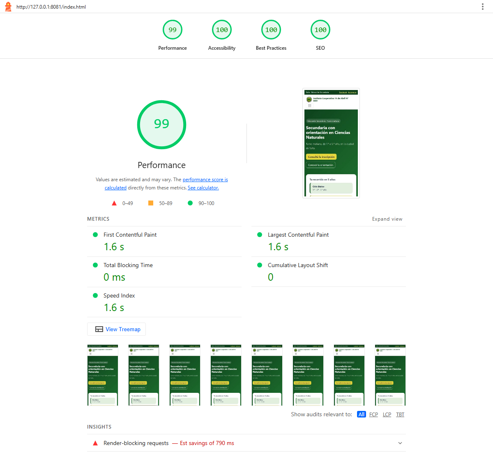
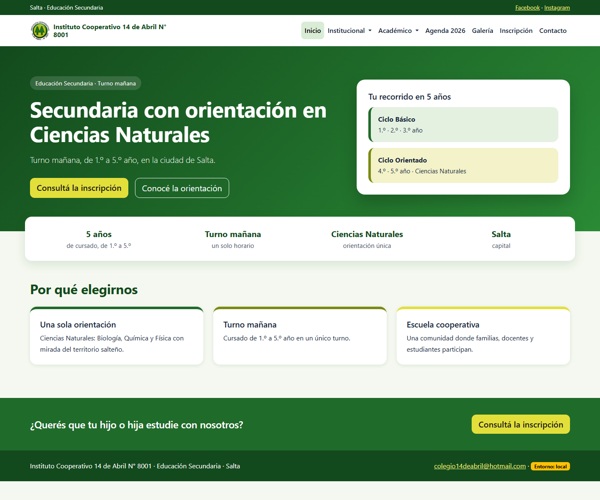
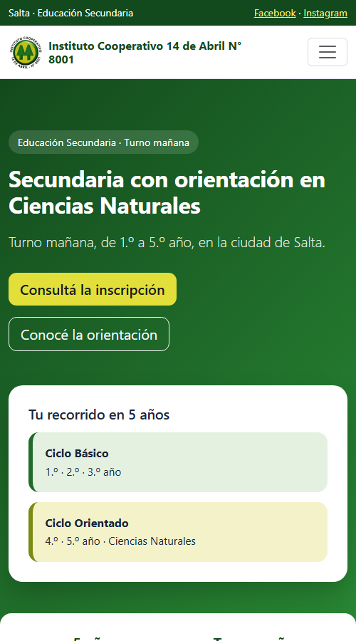

# Auditoría de accesibilidad (Lighthouse) — TP3

- Fecha de la auditoría: **22/11/2026**
- Herramienta: **Lighthouse 13.6.0** sobre Chrome headless, modo Navigation.
- Sitio auditado: versión estática HTML5 de las 10 vistas, servida en `http://127.0.0.1:8081/`.
- Publicación estática: <https://fer-2026.github.io/Pagina-PHP/>.

## Resultados finales — Mobile

| Vista | Performance | Accesibilidad | Best Practices | SEO |
|---|---:|---:|---:|---:|
| `index.html` | 99 | 100 | 100 | 100 |
| `institucional.html` | 99 | 100 | 100 | 100 |
| `docentes.html` | 99 | 100 | 100 | 100 |
| `propuesta-educativa.html` | 99 | 100 | 100 | 100 |
| `plan-de-estudios.html` | 99 | 100 | 100 | 100 |
| `ciencias-naturales.html` | 99 | 100 | 100 | 100 |
| `agenda.html` | 98 | 100 | 100 | 100 |
| `galeria.html` | 99 | 100 | 100 | 100 |
| `inscripcion.html` | 99 | 100 | 100 | 100 |
| `contacto.html` | 99 | 100 | 100 | 100 |

## Resultados finales — Desktop

| Vista | Performance | Accesibilidad | Best Practices | SEO |
|---|---:|---:|---:|---:|
| `index.html` | 100 | 100 | 100 | 100 |
| `institucional.html` | 100 | 100 | 100 | 100 |
| `docentes.html` | 100 | 100 | 100 | 100 |
| `propuesta-educativa.html` | 100 | 100 | 100 | 100 |
| `plan-de-estudios.html` | 100 | 100 | 100 | 100 |
| `ciencias-naturales.html` | 100 | 100 | 100 | 100 |
| `agenda.html` | 100 | 100 | 100 | 100 |
| `galeria.html` | 100 | 100 | 100 | 100 |
| `inscripcion.html` | 100 | 100 | 100 | 100 |
| `contacto.html` | 100 | 100 | 100 | 100 |



## Fallas detectadas y correcciones

La primera pasada detectó un único problema de accesibilidad, repetido en 9 vistas: el enlace del breadcrumb usaba el azul por defecto de Bootstrap (`#0d6efd`) sobre el fondo verde claro (`#e4efe0`), con una relación de contraste de **3.79:1**, inferior al mínimo de 4.5:1.

| Falla | Vistas afectadas | Corrección | Rama |
|---|---|---|---|
| Contraste insuficiente en enlaces del breadcrumb | `institucional`, `docentes`, `propuesta-educativa`, `plan-de-estudios`, `ciencias-naturales`, `agenda`, `galeria`, `inscripcion`, `contacto` | Se agregó `css/tp3.css` con enlaces en verde oscuro `#0a5a18` (y hover `#073f10`), manteniendo 100 de accesibilidad | `feature/maquetacion` |

Después de la corrección se volvieron a ejecutar las 20 auditorías (10 vistas en Mobile y 10 en Desktop). **Accesibilidad, Best Practices y SEO quedaron en 100 en todas las vistas.**
Performance quedó en 98–99 en Mobile y 100 en Desktop; el único aviso restante es una sugerencia de performance por solicitudes que bloquean el renderizado de Bootstrap desde CDN, no una falla de accesibilidad.

## Comandos utilizados

```bash
# Una vista en modo Mobile
npx lighthouse http://127.0.0.1:8081/index.html \
  --output=json --output-path=index-mobile.json \
  --chrome-flags="--headless=new --no-sandbox --disable-gpu" \
  --only-categories=performance,accessibility,best-practices,seo --quiet

# La misma vista en modo Desktop
npx lighthouse http://127.0.0.1:8081/index.html --preset=desktop \
  --output=json --output-path=index-desktop.json \
  --chrome-flags="--headless=new --no-sandbox --disable-gpu" \
  --only-categories=performance,accessibility,best-practices,seo --quiet

# Formato del código estático
npx prettier@3.3.3 --write "*.html" css/tp3.css
npx prettier@3.3.3 --check "*.html" css/tp3.css
```

## Medidas de accesibilidad aplicadas de base

- `lang="es"`, un solo `h1` por vista y jerarquía de títulos ordenada.
- Enlace «Saltar al contenido», landmarks `header`, `nav`, `main` y `footer`.
- `aria-current="page"` en el ítem activo del menú, foco visible y `prefers-reduced-motion`.
- Formulario con `label` asociado; tablas con `caption` y `scope`.
- Imágenes con `alt`, `width` y `height`; enlaces externos avisan que abren otra pestaña.

## Capturas de la versión estática




