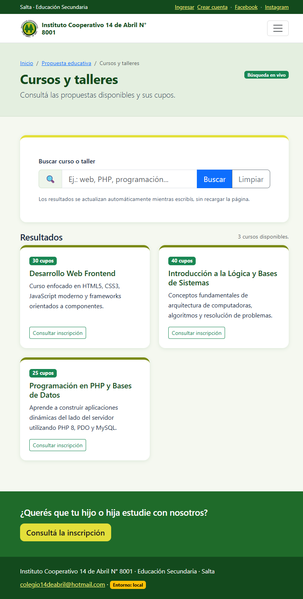
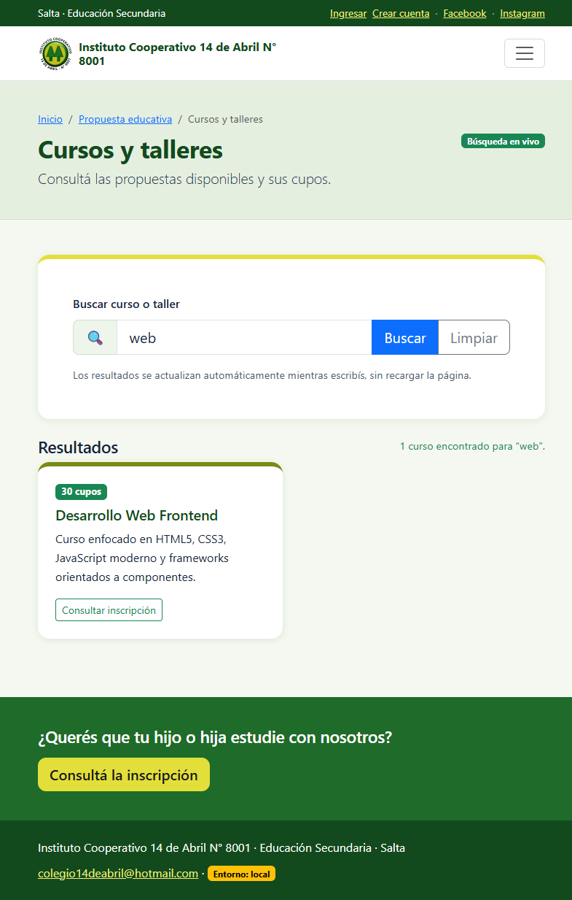
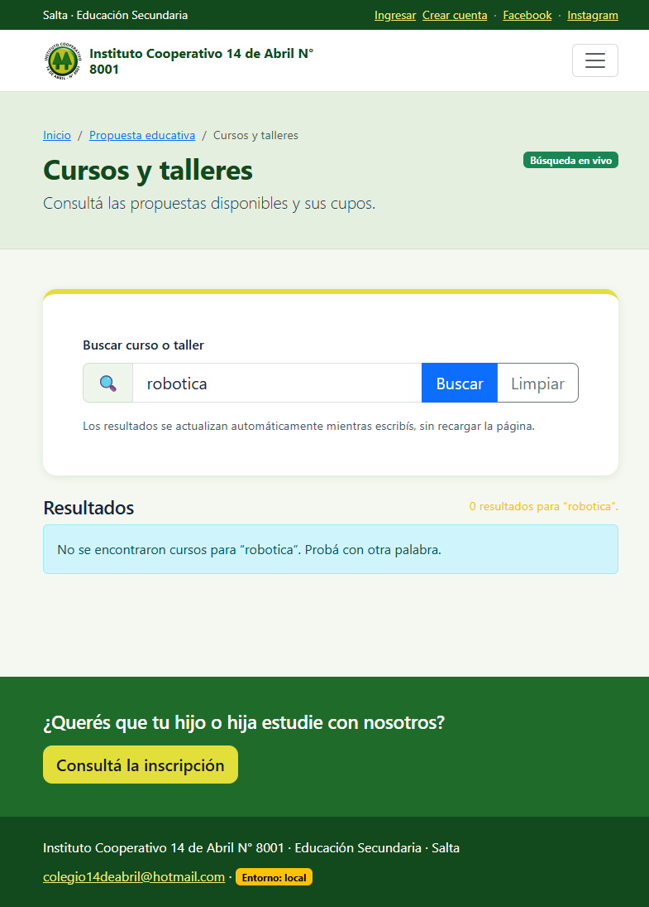
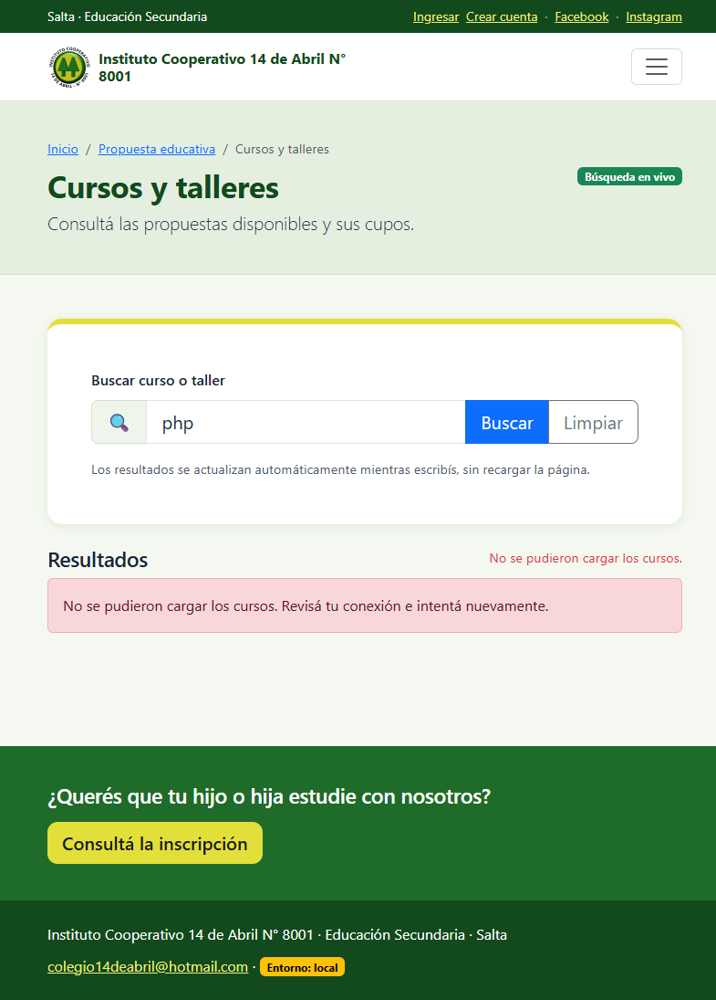
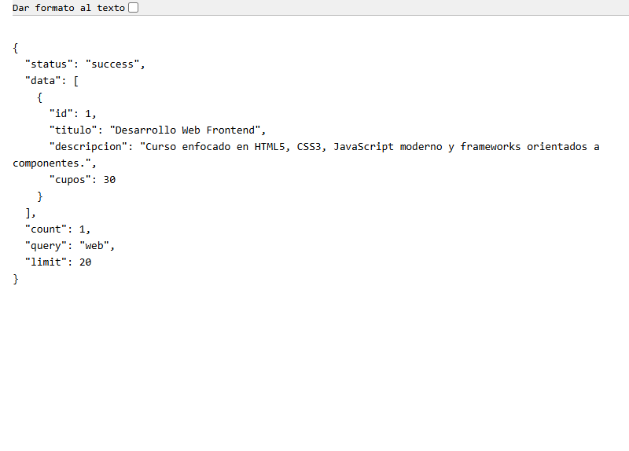
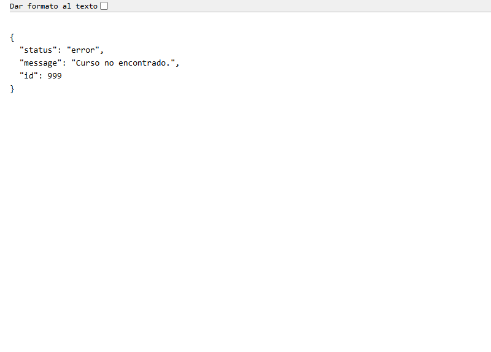
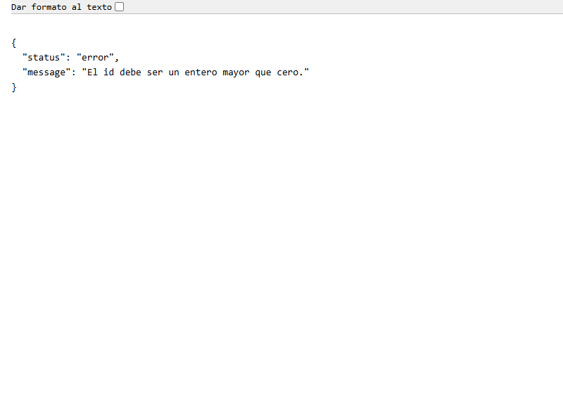
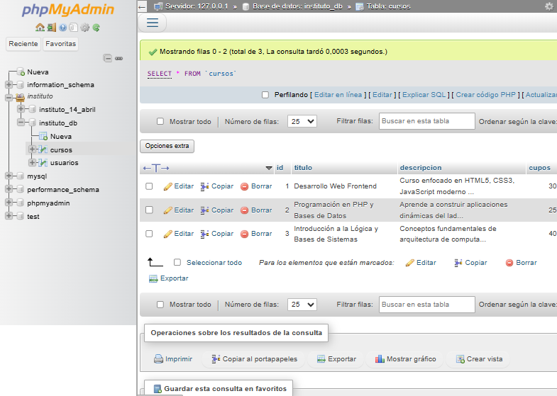

# TP9: Comunicación asincrónica y APIs (AJAX & JSON)

## Objetivo

Integrar al sitio del Instituto un buscador de **Cursos y talleres** que consulte una API propia y actualice solamente la sección de resultados, sin recargar la página.

La entrega cumple con:

- Un endpoint PHP independiente que devuelve JSON.
- Consultas a MySQL con PDO y sentencias preparadas.
- Códigos HTTP coherentes con el resultado de cada operación.
- Un evento del usuario (`input`, `submit` o `click`) que dispara `fetch()`.
- Manejo de errores con `try/catch`.
- Procesamiento de la respuesta JSON y actualización del DOM.
- Integración con el diseño, la navegación y la base de datos del sitio.

## Funcionalidad

La página pública [`cursos.php`](../cursos.php) muestra los cursos y talleres disponibles. El usuario puede escribir en el buscador y los resultados se actualizan automáticamente después de una pequeña pausa (debounce de 300 ms). También puede presionar **Buscar** o **Limpiar**.

El endpoint [`api/cursos.php`](../api/cursos.php) lee la tabla `cursos` de la base `instituto_db` y responde en formato JSON. La tabla ya se utilizaba en el CRUD del TP7; para una instalación limpia se agregó [`sql/cursos_tp9.sql`](../sql/cursos_tp9.sql) con el esquema y tres registros de ejemplo.

### Archivos principales

| Archivo | Función |
|---|---|
| `api/cursos.php` | Endpoint JSON, validación de parámetros, PDO y códigos HTTP. |
| `cursos.php` | Página pública con el buscador y el contenedor de resultados. |
| `js/cursos.js` | Eventos, debounce, Fetch API, `AbortController`, manejo de errores y renderizado. |
| `css/styles.css` | Estilos del buscador, las tarjetas, el estado de carga y los avisos. |
| `sql/cursos_tp9.sql` | Esquema y datos de ejemplo de la tabla `cursos`. |
| `includes/nav.php` | Enlace **Académico → Cursos y talleres**. |
| `propuesta-educativa.php` | Acceso directo a la nueva página. |

## Contrato del endpoint

Base: `http://localhost/instituto-php/api/cursos.php`

| Método | Parámetros | Resultado esperado |
|---|---|---|
| `GET` | Sin parámetros | Lista todos los cursos (máximo 20), ordenados por título. |
| `GET` | `q=texto` | Busca el texto en `titulo` o `descripcion`. Una búsqueda vacía devuelve todos. |
| `GET` | `id=1` | Devuelve el detalle de un curso. |
| Otro método | — | `405 Method Not Allowed` con cabecera `Allow: GET`. |

### Códigos HTTP

| Código | Situación |
|---|---|
| `200 OK` | Listado, búsqueda o detalle correcto. También se usa para una búsqueda sin coincidencias. |
| `400 Bad Request` | `id` no numérico o menor que 1; `q` que no es texto o supera los 100 caracteres. |
| `404 Not Found` | El `id` solicitado no existe. |
| `405 Method Not Allowed` | Se intenta usar un método distinto de `GET`. |
| `500 Internal Server Error` | Error al ejecutar la consulta o al acceder a la base. |

Todas las respuestas incluyen `Content-Type: application/json; charset=utf-8` y se generan con `json_encode()`.

### Ejemplo de respuesta correcta

```json
{
  "status": "success",
  "data": [
    {
      "id": 1,
      "titulo": "Desarrollo Web Frontend",
      "descripcion": "Curso enfocado en HTML5, CSS3, JavaScript moderno y frameworks orientados a componentes.",
      "cupos": 30
    }
  ],
  "count": 1,
  "query": "web",
  "limit": 20
}
```

### Ejemplo de respuesta de error

```json
{
  "status": "error",
  "message": "Curso no encontrado.",
  "id": 999
}
```

## Pruebas realizadas

**Entorno:** Windows 11, XAMPP con Apache 2.4.58, PHP 8.2.12 y MariaDB 10.4.32. Navegador Chromium. Base de datos `instituto_db`.

### 1. Endpoint

| # | Caso | Acción | Resultado obtenido |
|---|---|---|---|
| 1 | Listado completo | `GET /api/cursos.php` | `200 OK`; `count: 3`; los tres cursos. |
| 2 | Búsqueda con resultados | `GET /api/cursos.php?q=web` | `200 OK`; `count: 1`; “Desarrollo Web Frontend”. |
| 3 | Búsqueda sin resultados | `GET /api/cursos.php?q=zzz` | `200 OK`; `count: 0`; arreglo `data` vacío. |
| 4 | Detalle | `GET /api/cursos.php?id=1` | `200 OK`; datos del curso 1; `count: 1`. |
| 5 | ID inexistente | `GET /api/cursos.php?id=999` | `404 Not Found`; mensaje “Curso no encontrado.”. |
| 6 | ID inválido | `GET /api/cursos.php?id=abc` | `400 Bad Request`; mensaje sobre entero mayor que cero. |
| 7 | Búsqueda demasiado larga | `GET /api/cursos.php?q=` + 101 caracteres | `400 Bad Request`; límite de 100 caracteres. |
| 8 | Método no permitido | `POST /api/cursos.php` | `405 Method Not Allowed`; cabecera `Allow: GET`. |
| 9 | Intento de inyección SQL | `GET /api/cursos.php?q=' OR 1=1 --` | `200 OK`; `count: 0`. La cadena se trata como texto, no como SQL. |

Todas las respuestas verificadas con `curl -i` incluyeron `Content-Type: application/json; charset=utf-8`.

### 2. Página y Fetch API

| # | Caso | Acción | Resultado obtenido |
|---|---|---|---|
| 10 | Carga inicial | Abrir `cursos.php` | Se muestran 3 tarjetas y el estado “3 cursos disponibles.”. |
| 11 | Búsqueda en vivo | Escribir `web` en el buscador | Se muestra 1 tarjeta; estado “1 curso encontrado para ‘web’.”. |
| 12 | Sin recarga | Comparar antes y después de buscar | `performance.getEntriesByType('navigation').length` sigue siendo `1`; una variable global de prueba se conserva. |
| 13 | Sin coincidencias | Escribir `robotica` | 0 tarjetas y aviso “No se encontraron cursos para ‘robotica’.”. |
| 14 | Botón Buscar | Enviar el formulario con `php` | 1 tarjeta; el `submit` se intercepta con `preventDefault()` y no recarga. |
| 15 | Botón Limpiar | Presionar **Limpiar** | El campo queda vacío y vuelven las 3 tarjetas. |
| 16 | Error de red | Simular un rechazo de `fetch()` desde la consola | Se muestra una alerta roja con el mensaje de error; la página sigue funcionando. |
| 17 | Petición real | Revisar la pestaña Red | `GET api/cursos.php?q=web` de tipo `fetch`, `200`, 72,33 ms; respuesta JSON. |

La prueba de error de red se hizo reemplazando temporalmente `window.fetch` por una función que rechaza la promesa. Luego se restauró la función original. No se modificó el código de la aplicación para esa prueba.

### 3. Respuesta JSON y base de datos

La respuesta de `?q=web` fue:

```json
{"status":"success","data":[{"id":1,"titulo":"Desarrollo Web Frontend","descripcion":"Curso enfocado en HTML5, CSS3, JavaScript moderno y frameworks orientados a componentes.","cupos":30}],"count":1,"query":"web","limit":20}
```

La tabla `cursos` de `instituto_db` contiene 3 registros. Las comillas simples que habían quedado como parte del texto de prueba en algunos títulos y descripciones se quitaron antes de las capturas para que el contenido se viera correctamente.

No se detuvo MySQL durante las pruebas para no afectar el resto del sitio. El bloque `catch (Throwable $error)` del endpoint devuelve `500` si PDO lanza una excepción durante una consulta.

## Capturas de evidencia

Todas las imágenes están en [`docs/capturas/tp9/`](capturas/tp9/).

1. **Página inicial con los tres cursos**

   

2. **Búsqueda “web” actualizada sin recargar**

   

3. **Búsqueda sin coincidencias**

   

4. **Error de red simulado y manejado por la interfaz**

   

5. **Endpoint JSON con búsqueda y código 200**

   

6. **Endpoint JSON con ID inexistente y código 404**

   

7. **Endpoint JSON con ID inválido y código 400**

   

8. **Tabla `cursos` en phpMyAdmin**

   

## Cómo reproducir

1. Iniciar **Apache** y **MySQL** desde XAMPP.
2. Si la base está vacía, importar [`sql/cursos_tp9.sql`](../sql/cursos_tp9.sql) desde phpMyAdmin o con el cliente de MySQL.
3. Abrir `http://localhost/instituto-php/cursos.php`.
4. Probar las búsquedas `web`, `php`, `robotica` y los botones **Buscar** y **Limpiar**.
5. Para probar el endpoint directamente:

```bash
curl -i "http://localhost/instituto-php/api/cursos.php"
curl -i "http://localhost/instituto-php/api/cursos.php?q=web"
curl -i "http://localhost/instituto-php/api/cursos.php?id=999"
curl -i -X POST "http://localhost/instituto-php/api/cursos.php"
```

## Seguridad y accesibilidad

- Las consultas usan `PDO::prepare()` y parámetros con nombre.
- El `id` se valida con `filter_var(..., FILTER_VALIDATE_INT)`.
- La búsqueda se limita a 100 caracteres.
- La respuesta se genera con `json_encode()` y cabeceras JSON explícitas.
- El frontend construye las tarjetas con `createElement()` y `textContent`, sin insertar datos de la base con `innerHTML`.
- El buscador tiene `<label>`, `aria-describedby`, `aria-live`, `aria-busy` y un aviso `<noscript>`.
- Se usa `AbortController` para cancelar una petición anterior si el usuario sigue escribiendo.

## Conclusión

La página de Cursos y talleres consume una API JSON propia mediante Fetch, actualiza solo la sección de resultados y contempla estados de carga, sin resultados y error. El endpoint utiliza PDO con consultas preparadas, responde con los códigos HTTP correspondientes y queda integrado a la navegación y al diseño existente del sitio.
