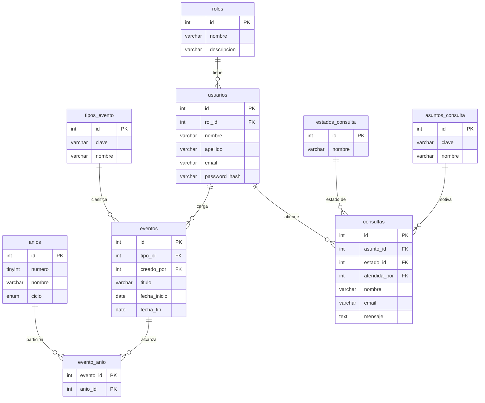

# TP6, Parte 1: Normalización del proyecto

**Proyecto:** sitio web del Instituto Cooperativo 14 de Abril N.º 8001 (Salta).
**Base de datos:** `instituto_14_abril`.

El sitio maneja una agenda escolar (actos, feriados, jornadas, receso, comisiones evaluadoras), usuarios con distintos roles que la administran y consultas que llegan por el formulario de contacto.

---

## 1. Entidad principal sin normalizar

Registro hipotético de la agenda tal como podría guardarse en una sola tabla `agenda`:

| evento_id | titulo | fecha | tipo_clave | tipo_nombre | anios | creado_por_email | creado_por_nombre | rol | rol_descripcion |
|---|---|---|---|---|---|---|---|---|---|
| 1 | Promesa de lealtad a la Constitución | 2026-05-11 | acto | Acto escolar | 3.º | secretaria@example.com | Andrea Cruz | secretaria | Carga eventos y responde consultas |
| 2 | Jornada de acuerdos de convivencia | 2026-04-14 | jornada | Jornada institucional | 1.º, 2.º, 3.º, 4.º, 5.º | admin@example.com | María Elena Rojas | administrador | Gestiona usuarios, agenda y consultas |
| 3 | Día Nacional de la Memoria | 2026-03-24 | feriado | Feriado | 1.º, 2.º, 3.º, 4.º, 5.º | secretaria@example.com | Andrea Cruz | secretaria | Carga eventos y responde consultas |

**Problemas que se observan**
- **Campo multivalorado:** `anios` guarda una lista de años en un solo campo. No se puede buscar ni filtrar por un año con precisión.
- **Redundancia:** el nombre y la descripción de la persona, su rol y el nombre del tipo de evento se repiten en cada fila. Si cambia el nombre de "Andrea Cruz" o la descripción del rol, hay que modificar muchas filas y es fácil dejar datos inconsistentes (anomalías de actualización, inserción y borrado).

---

## 2. Proceso de normalización

### Primera forma normal (1FN): valores atómicos
Se elimina la lista de años: **cada fila representa un evento para un año**. La clave primaria pasa a ser compuesta: `(evento_id, anio)`.

| **evento_id** | **anio** | titulo | fecha | tipo_clave | tipo_nombre | creado_por_email | creado_por_nombre | rol | rol_descripcion |
|---|---|---|---|---|---|---|---|---|---|
| 1 | 3.º | Promesa de lealtad a la Constitución | 2026-05-11 | acto | Acto escolar | secretaria@example.com | Andrea Cruz | secretaria | Carga eventos… |
| 2 | 1.º | Jornada de acuerdos de convivencia | 2026-04-14 | jornada | Jornada institucional | admin@example.com | María Elena Rojas | administrador | Gestiona… |
| 2 | 2.º | Jornada de acuerdos de convivencia | 2026-04-14 | jornada | Jornada institucional | admin@example.com | María Elena Rojas | administrador | Gestiona… |
| … | … | … | … | … | … | … | … | … | … |

Todos los campos son atómicos, pero ahora el título, la fecha, el tipo y el autor se repiten una vez por cada año.

### Segunda forma normal (2FN): sin dependencias parciales
Con la clave compuesta `(evento_id, anio)`:
- `titulo`, `fecha`, `tipo_*`, `creado_por_*`, `rol*` dependen **solo de `evento_id`** (parte de la clave). Es una dependencia parcial.
- Lo único que depende de la clave completa es la relación "este evento alcanza a este año".

Se descompone en dos tablas:

**`eventos`**: PK `evento_id`
| evento_id | titulo | fecha | tipo_clave | tipo_nombre | creado_por_email | creado_por_nombre | rol | rol_descripcion |
|---|---|---|---|---|---|---|---|---|

**`evento_anio`**: PK `(evento_id, anio)`
| evento_id | anio |
|---|---|
| 1 | 3.º |
| 2 | 1.º |
| 2 | 2.º |
| … | … |

Además, los datos del año (nombre, ciclo Básico u Orientado) dependen solo del año, por lo que el año pasa a ser una tabla propia `anios`.

### Tercera forma normal (3FN): sin dependencias transitivas
En `eventos` todavía hay atributos que dependen de otro atributo que no es la clave:
- `tipo_nombre` depende de `tipo_clave` (no de `evento_id`) → se extrae **`tipos_evento`**.
- `creado_por_nombre` depende de `creado_por_email` → se extrae **`usuarios`**.
- `rol_descripcion` depende de `rol`, que a su vez depende del usuario → se extrae **`roles`**.

Resultado: `eventos` conserva solo `titulo`, `descripcion`, fechas y las claves foráneas `tipo_id` y `creado_por`.

### Normalización de las consultas
La tabla de consultas del formulario de contacto repetía el texto del **asunto** ("Consulta de inscripción") y del **estado** ("Pendiente") en cada fila. Se extrajeron a `asuntos_consulta` y `estados_consulta`, y `consultas` guarda solo sus claves.

---

## 3. Tablas resultantes

| Tabla | Tipo | Clave primaria (PK) | Claves foráneas (FK) |
|---|---|---|---|
| `roles` | Maestra | `id` | |
| `usuarios` | Principal (autenticación) | `id` | `rol_id` → `roles.id` |
| `tipos_evento` | Maestra | `id` | |
| `anios` | Maestra | `id` | |
| `eventos` | **Principal de negocio** | `id` | `tipo_id` → `tipos_evento.id`; `creado_por` → `usuarios.id` |
| `evento_anio` | **Relación N:M** | `(evento_id, anio_id)` | `evento_id` → `eventos.id`; `anio_id` → `anios.id` |
| `asuntos_consulta` | Maestra | `id` | |
| `estados_consulta` | Maestra | `id` | |
| `consultas` | **Principal de negocio** | `id` | `asunto_id` → `asuntos_consulta.id`; `estado_id` → `estados_consulta.id`; `atendida_por` → `usuarios.id` |

**Relaciones**
- Un rol tiene muchos usuarios (1:N).
- Un usuario carga muchos eventos y atiende muchas consultas (1:N). Si se borra, esos registros quedan con el campo en `NULL` (`ON DELETE SET NULL`).
- Un tipo de evento clasifica muchos eventos (1:N).
- Un evento alcanza muchos años y un año tiene muchos eventos (**N:M** mediante `evento_anio`).
- Un asunto y un estado se asignan a muchas consultas (1:N).

### Diagrama entidad-relación

## 4. Decisiones de diseño
- **Contraseñas:** se guarda `password_hash` (resultado de `password_hash()` de PHP), nunca la clave en texto plano.
- **Integridad:** claves foráneas con `RESTRICT` en las maestras (no se puede borrar un rol o tipo en uso), `SET NULL` para el autor y `CASCADE` en la tabla N:M.
- **Validación en la base:** restricciones `UNIQUE` (email, nombre de rol) y un `CHECK` que impide que `fecha_fin` sea anterior a `fecha_inicio`.
- **Índices:** `idx_eventos_fecha` (la agenda se consulta por fecha), `idx_consultas_estado_fecha` (el panel filtra por estado y ordena por antigüedad) e `idx_consultas_email` (historial por persona).
- **Auditoría:** `created_at` y `updated_at` en las tablas principales.
