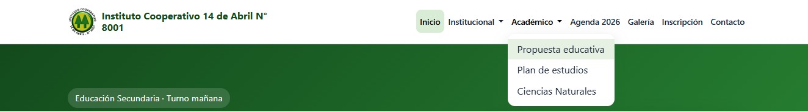
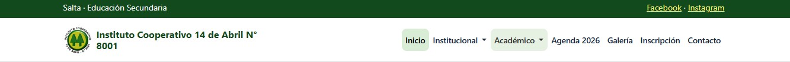

# Instituto Cooperativo 14 de Abril N.º 8001: sitio web

Sitio web del instituto (Salta): Educación Secundaria, turno mañana, 1.º a 5.º año, Bachiller en Ciencias Naturales.

> **Ubicación del proyecto completo:** el código actualizado está en [`Desktop/Fer/instituto-php/`](Desktop/Fer/instituto-php/). Las secciones de TP6 a TP10 y las instrucciones de ejecución se refieren a esa carpeta.

## Descripción y refactorización (Unidad 4)
El sitio estático del Hito 1 se migró a **PHP**:
- Las 10 vistas pasaron de `.html` a `.php`.
- Se aplicó **Server Side Includes**: `header.php`, `nav.php` y `footer.php` en `includes/` eliminan el código repetido.
- **SSR básico:** el `<title>` cambia según `$titulo_pagina` y el menú marca la página activa (`active` y `aria-current`).
- **Variables de entorno:** `.env` (ignorado por Git) con `.env.example` como plantilla, leído por `config/env.php`.

## Prototipo de Figma
- Figma: https://github.com/Fer-2026/Dise-o-UI-UX-Mockup-Figma-
- Mockups exportados: https://www.figma.com/make/UL3GSEQOHBF6XCXKV9COQ8/High-Fidelity-Mockups-for-School?t=qmuPPG4mTDi6oJpE-1

## Tecnologías
HTML5, CSS3, Bootstrap 5.3, JavaScript, PHP 8.x, XAMPP / Laragon, Git y GitHub, Prettier.

## Estructura
```
config/env.php        carga de variables de entorno
includes/             header.php, nav.php, footer.php
css/  js/  img/       recursos
*.php                 10 vistas
.env.example          plantilla de variables
```
## Instalación y ejecución local
1. Instalá **XAMPP** (o **Laragon**) con PHP 8.x.
2. Cloná el repositorio dentro de la carpeta del servidor:
   - XAMPP: `C:\xampp\htdocs\`
   - Laragon: `C:\laragon\www\`
```bash
git clone https://github.com/Fer-2026/Pagina-PHP.git
# El proyecto completo está en Pagina-PHP/Desktop/Fer/instituto-php:
# copiá esa carpeta a htdocs/instituto-php (o configurá el DocumentRoot).
cd Pagina-PHP/Desktop/Fer/instituto-php
cp .env.example .env
```
3. Iniciá **Apache** (XAMPP: botón *Start*; Laragon: *Iniciar todo*).
4. Abrí http://localhost/instituto-php/
5. Edit­á `.env` si querés cambiar el nombre, el correo o el entorno.

Alternativa sin XAMPP: `php -S localhost:8000` dentro de la carpeta.

## Evidencia de funcionamiento





## Flujo de Git
Ramas `feature/maquetacion` y `feature/migracion-php-ssi`, integradas a `main` con Pull Request.

## Fuentes
Datos del instituto: sitios públicos y su perfil de Instagram. Los nombres del equipo docente son ficticios (maqueta). Agenda: PDF institucional 2026.

## TP6: Diseño y creación del esquema relacional en MySQL

El TP6 está en la carpeta [`Desktop/Fer/instituto-php/tp6/`](Desktop/Fer/instituto-php/tp6/):

- [`NORMALIZACION.md`](Desktop/Fer/instituto-php/tp6/NORMALIZACION.md): normalización paso a paso (1FN, 2FN, 3FN), tablas con claves y diagrama entidad-relación.
- [`schema.sql`](Desktop/Fer/instituto-php/tp6/schema.sql): creación de la base `instituto_14_abril` con 9 tablas, claves primarias y foráneas, campos de auditoría e índices.
- [`consultas.sql`](Desktop/Fer/instituto-php/tp6/consultas.sql): inserciones, `SELECT` con `WHERE`, `ORDER BY` e `INNER JOIN`, `UPDATE` y `DELETE`.
- Capturas de evidencia: [`tp6/docs/capturas/`](Desktop/Fer/instituto-php/tp6/docs/capturas/).

Instrucciones de ejecución en [`tp6/README.md`](Desktop/Fer/instituto-php/tp6/README.md).

## TP7: CRUD de cursos

El TP7 agregó el CRUD de cursos que luego se conservó como base del TP9 y se refactorizó a MVC en el TP10. La versión actual está en:

- [`admin/index.php`](Desktop/Fer/instituto-php/admin/index.php) como front controller, con las URL históricas `crear.php`, `editar.php` y `eliminar.php` como capas de compatibilidad.
- [`app/Models/Curso.php`](Desktop/Fer/instituto-php/app/Models/Curso.php), [`app/Controllers/CursoController.php`](Desktop/Fer/instituto-php/app/Controllers/CursoController.php) y [`app/Views/cursos/`](Desktop/Fer/instituto-php/app/Views/cursos/).
- [`sql/cursos_tp9.sql`](Desktop/Fer/instituto-php/sql/cursos_tp9.sql) con el esquema y los datos de ejemplo.
- Pruebas de regresión en [`docs/tp7-pruebas.md`](Desktop/Fer/instituto-php/docs/tp7-pruebas.md).

Capturas: [CRUD en el panel](Desktop/Fer/instituto-php/docs/capturas/tp8/12-cursos-admin.png) y [listado MVC](Desktop/Fer/instituto-php/docs/capturas/tp10/01-nativo-listado.png).

## TP8: Manejo de estado, sesiones y autenticación

La implementación completa del TP8 está integrada en [`Desktop/Fer/instituto-php/`](Desktop/Fer/instituto-php/). Incluye:

- `registro.php`, `login.php`, `logout.php`, `dashboard.php` y `admin_panel.php`.
- `auth_guard.php` para exigir sesión y restringir el rol `admin`.
- `sql/usuarios_tp8.sql` con la tabla `usuarios` y las cuentas semilla.
- Capturas de evidencia en [`Desktop/Fer/instituto-php/docs/capturas/tp8/`](Desktop/Fer/instituto-php/docs/capturas/tp8/).
- Detalle de las pruebas en [`Desktop/Fer/instituto-php/docs/tp8-pruebas.md`](Desktop/Fer/instituto-php/docs/tp8-pruebas.md).
- Documentación completa en [`Desktop/Fer/instituto-php/README.md`](Desktop/Fer/instituto-php/README.md).

Cuentas de prueba: `admin@instituto.edu.ar` / `Admin123!` y `usuario@instituto.edu.ar` / `Usuario123!`.

## TP9: Comunicación asincrónica y APIs (AJAX & JSON)

La implementación completa del TP9 está integrada en [`Desktop/Fer/instituto-php/`](Desktop/Fer/instituto-php/). Incluye:

- `cursos.php` y `js/cursos.js`: buscador público con Fetch API, debounce, estados de carga y manejo de errores.
- `api/cursos.php`: endpoint independiente con PDO, consultas preparadas, `json_encode()` y códigos HTTP `200`, `400`, `404`, `405` y `500`.
- `sql/cursos_tp9.sql`: esquema y datos de ejemplo de la tabla `cursos`.
- Integración en la navegación y en `propuesta-educativa.php`.
- Capturas de evidencia en [`Desktop/Fer/instituto-php/docs/capturas/tp9/`](Desktop/Fer/instituto-php/docs/capturas/tp9/).
- Detalle de las pruebas en [`Desktop/Fer/instituto-php/docs/tp9-pruebas.md`](Desktop/Fer/instituto-php/docs/tp9-pruebas.md).
- Documentación completa en [`Desktop/Fer/instituto-php/README.md`](Desktop/Fer/instituto-php/README.md).

## TP10: Patrón MVC e introducción a frameworks

La implementación completa del TP10 está integrada en [`Desktop/Fer/instituto-php/`](Desktop/Fer/instituto-php/). Incluye:

- **Parte A:** CRUD de cursos refactorizado a MVC nativo en `app/Models/Curso.php`, `app/Controllers/CursoController.php` y `app/Views/cursos/`. `admin/index.php` quedó como front controller y las URL anteriores se conservan mediante capas de compatibilidad.
- **Parte B:** proyecto **CodeIgniter 4.7.6** en `tp10/framework/` con el módulo independiente **Novedades**, ruta, controlador, modelo con Query Builder, vistas con layout y endpoint JSON.
- Tabla `novedades` y datos de ejemplo en `sql/novedades_tp10.sql`.
- Capturas de evidencia en [`Desktop/Fer/instituto-php/docs/capturas/tp10/`](Desktop/Fer/instituto-php/docs/capturas/tp10/).
- Detalle de pruebas en [`Desktop/Fer/instituto-php/docs/tp10-pruebas.md`](Desktop/Fer/instituto-php/docs/tp10-pruebas.md).
- Documentación completa en [`Desktop/Fer/instituto-php/README.md`](Desktop/Fer/instituto-php/README.md).

Commit descriptivo del TP10: `feat: refactorizacion MVC e implementacion de modulo con framework`.
