# Instituto Cooperativo 14 de Abril N.º 8001: sitio web

Sitio web institucional (Salta): Educación Secundaria, turno mañana, 1.º a 5.º año, Bachiller en Ciencias Naturales.

> **Proyecto completo:** la versión actualizada está en [`Desktop/Fer/instituto-php/`](Desktop/Fer/instituto-php/). La documentación detallada, las instrucciones de instalación y **todas las capturas** están en el [README del proyecto](Desktop/Fer/instituto-php/README.md).
>
> **Para la corrección:** abrir esa carpeta como raíz del proyecto y usar el README completo. La copia de la raíz es la versión inicial del sitio.

## Documentación y accesos rápidos

- [README completo del proyecto](Desktop/Fer/instituto-php/README.md)
- [Carpeta general de capturas](Desktop/Fer/instituto-php/docs/capturas/)
- [Capturas de la Clase 5 / TP5](Desktop/Fer/instituto-php/clase5/docs/capturas/)
- [Capturas del TP6](Desktop/Fer/instituto-php/tp6/docs/capturas/)
- [Capturas del TP8](Desktop/Fer/instituto-php/docs/capturas/tp8/)
- [Capturas del TP9](Desktop/Fer/instituto-php/docs/capturas/tp9/)
- [Capturas del TP10](Desktop/Fer/instituto-php/docs/capturas/tp10/)
- [Pruebas del TP7](Desktop/Fer/instituto-php/docs/tp7-pruebas.md)
- [Pruebas del TP8](Desktop/Fer/instituto-php/docs/tp8-pruebas.md)
- [Pruebas del TP9](Desktop/Fer/instituto-php/docs/tp9-pruebas.md)
- [Pruebas del TP10](Desktop/Fer/instituto-php/docs/tp10-pruebas.md)

**Cuentas de prueba**

| Rol | Correo | Contraseña |
|---|---|---|
| admin | `admin@instituto.edu.ar` | `Admin123!` |
| usuario | `usuario@instituto.edu.ar` | `Usuario123!` |

## TP1: sitio estático y maquetación

Sitio construido con HTML5, CSS3 y Bootstrap 5.3, con 10 vistas y estructura común de header, navegación y footer.

## TP2: prototipo de Figma y diseño responsive

Prototipo visual y definición de la identidad del sitio antes de llevarlo a código.

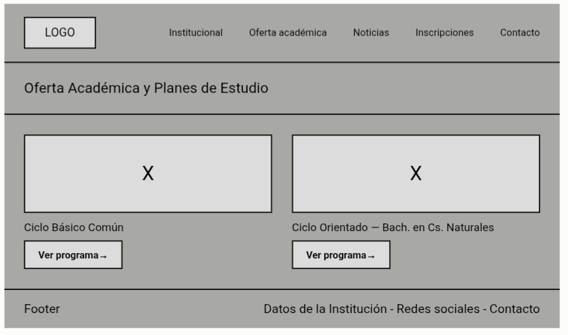

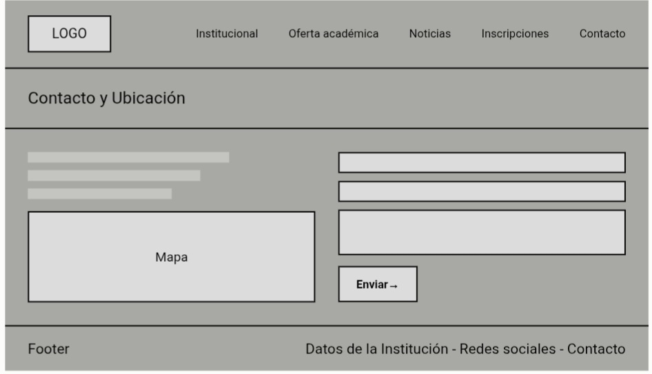

## TP3: navegación dinámica y componentes reutilizables

Menú generado desde un arreglo PHP, con estado activo, `aria-current` y componentes reutilizables en `includes/`.

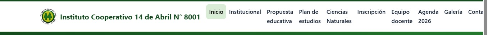

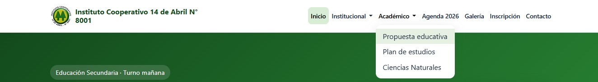

## TP4: migración a PHP, SSI y variables de entorno

Las 10 vistas pasaron a PHP y comparten header, nav y footer. El título se genera dinámicamente y la configuración se carga desde `.env`.

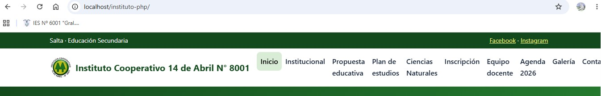

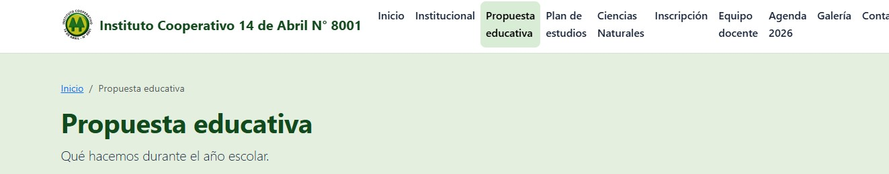

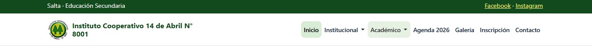

## TP5 / Clase 5: formularios y seguridad web

Formulario POST de contacto y buscador GET con sanitización, validación en servidor, escape XSS, token CSRF y patrón Post/Redirect/Get.

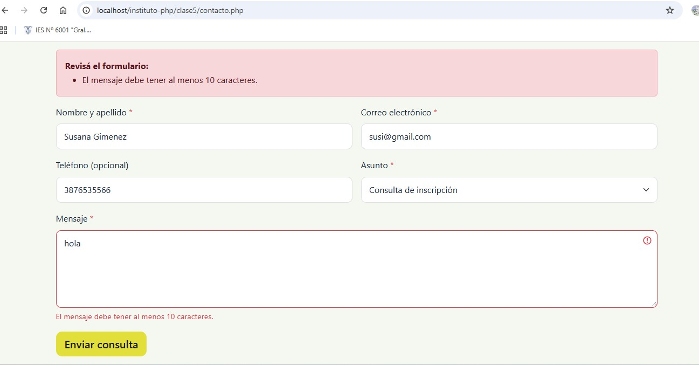

[Ver las 8 capturas de TP5](Desktop/Fer/instituto-php/clase5/docs/capturas/)

## TP6: diseño y creación del esquema relacional en MySQL

Base `instituto_14_abril` normalizada a 1FN, 2FN y 3FN, con 9 tablas, claves foráneas, índices y consultas CRUD.

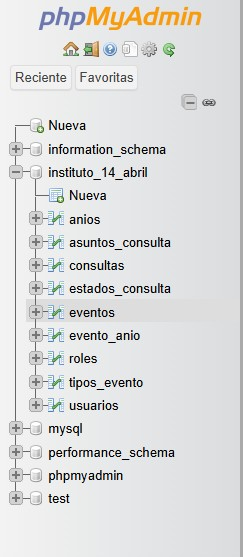

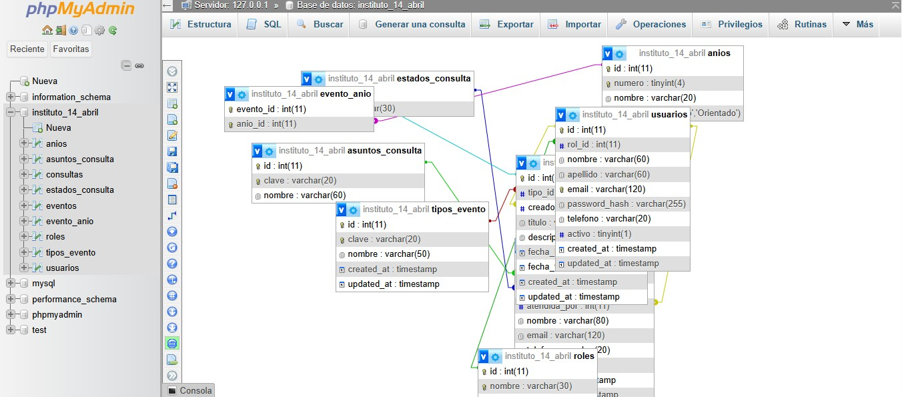

[Ver las 6 capturas de TP6](Desktop/Fer/instituto-php/tp6/docs/capturas/)

## TP7: CRUD de cursos

Listado, alta, edición y baja de cursos sobre la tabla `cursos` de `instituto_db`, con PDO, validación y CSRF.

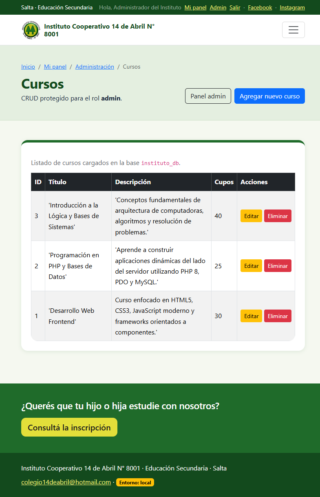

## TP8: manejo de estado, sesiones y autenticación

Registro, login, logout, sesión segura y control de acceso por roles.

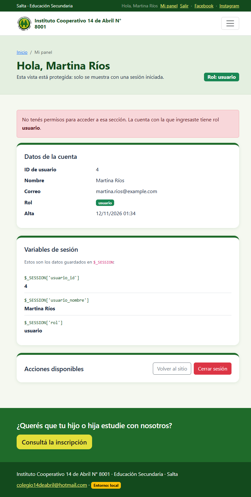

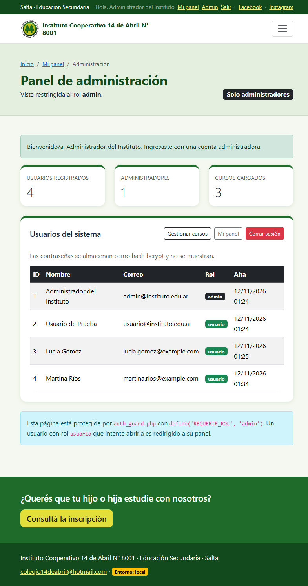

[Ver las 15 capturas de TP8](Desktop/Fer/instituto-php/docs/capturas/tp8/)

## TP9: comunicación asincrónica y API JSON

Buscador con Fetch API, debounce, actualización parcial del DOM y endpoint JSON con códigos HTTP.

[Ver las 8 capturas de TP9](Desktop/Fer/instituto-php/docs/capturas/tp9/)

## TP10: patrón MVC e introducción a frameworks

Parte A: CRUD de cursos refactorizado a MVC nativo. Parte B: módulo independiente de Novedades con CodeIgniter 4.

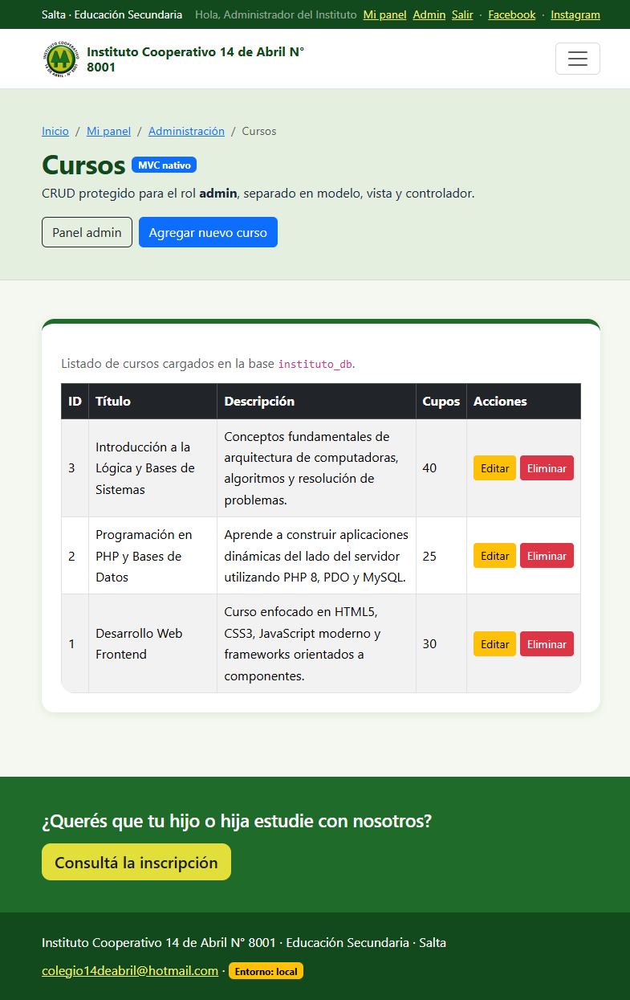

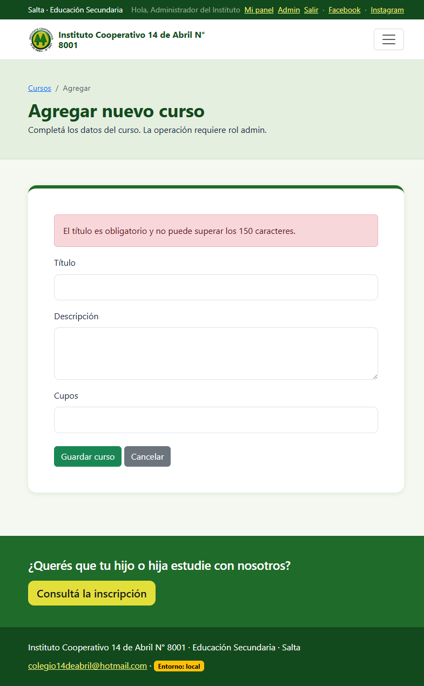

[Ver las 12 capturas de TP10](Desktop/Fer/instituto-php/docs/capturas/tp10/)

## Ejecución rápida

1. Iniciar **Apache** y **MySQL** desde XAMPP.
2. Copiar `Desktop/Fer/instituto-php/` a `htdocs/instituto-php/` o configurar el `DocumentRoot` apuntando a esa carpeta.
3. Abrir `http://localhost/instituto-php/`.
4. Para el módulo CodeIgniter, ejecutar `composer install` dentro de `tp10/framework/` si falta `vendor/`.

La explicación completa de cada TP, los requisitos y las pruebas están en el [README del proyecto](Desktop/Fer/instituto-php/README.md).
